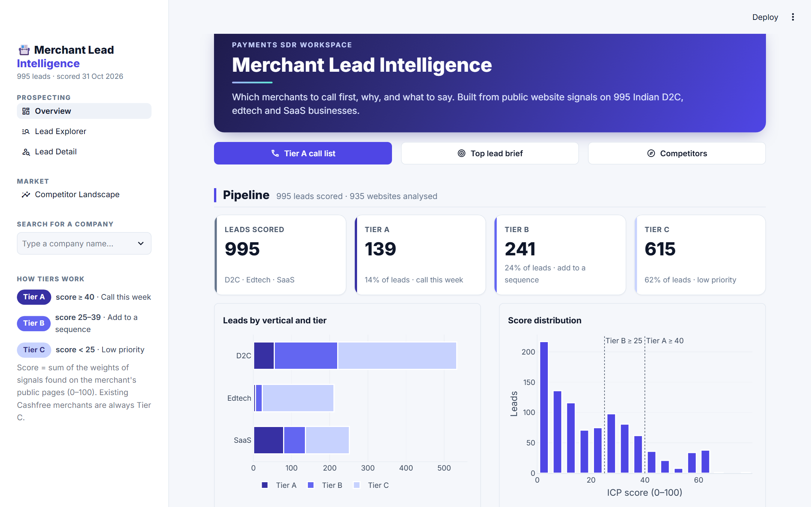
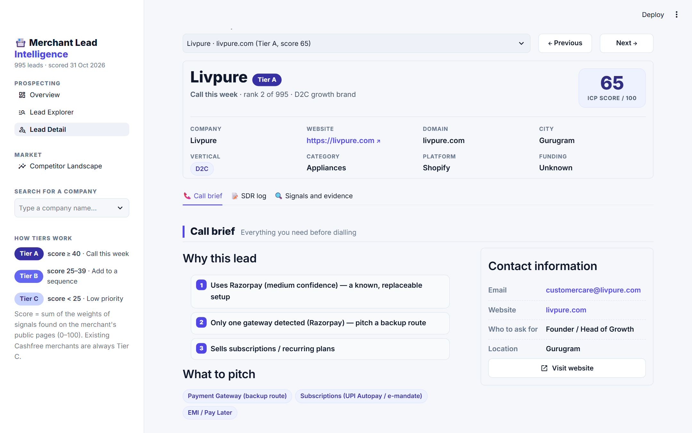
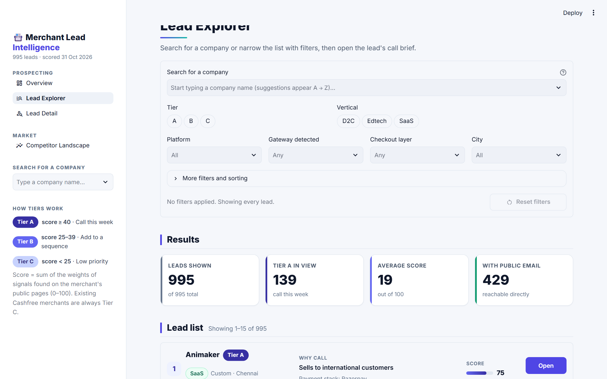

# Merchant Lead Intelligence Engine

> **It tells a payments SDR which merchants to call first, why, and what to say.**

[](https://github.com/Anshuman0716/Merchant-Lead-Intelligence/actions/workflows/ci.yml)
**Live demo:** _link coming after deploy_ · **2-min walkthrough:** _video coming_



## The problem

SDRs at payment companies spend a large share of their week researching merchants: which
platform they're on, which gateway they use, whether they sell subscriptions or abroad. Many of
those leads turn out to be a poor fit. This project automates that research from public
websites, so an SDR starts the day with a ranked list, a reason for each call, and a first line
to say.

## What it does

- **Builds a merchant universe:** 1,072 Indian D2C, edtech and SaaS businesses, cleaned and
  deduplicated. Bad rows are quarantined with a reason, never deleted.
- **Detects each merchant's payment setup from public pages:** platform, payment gateway (with an
  evidence level), checkout layer, subscriptions, international sales, COD, EMI, apps and a public
  contact email.
- **Scores every merchant against 3 ICPs** with transparent rules: score 0–100, Tier A/B/C, top 3
  reasons, BANT best guesses, suggested products and a one-line opener.
- **Delivers it where sales teams work:** a 4-page Streamlit dashboard, a HubSpot import CSV, a
  Tier A call list, 20 cold emails and a one-page insight note.

## Results

| | |
|---|---|
| Merchants | 1,072 seeded → **942 valid** (505 D2C, 198 edtech, 239 SaaS) + 53 bot-blocked scored on seed data |
| Leads | **995 scored: Tier A 139 (14%) · B 241 (24%) · C 615 (62%)** |
| Pages crawled | 4,300+ public page fetches from 934 sites (robots.txt respected) |
| Platform | Shopify 313 · WooCommerce 20 · Magento 11 · custom 591 |
| Checkout layer visible | 27% of sites (GoKwik 149, Razorpay Magic 39, Shiprocket 35, Shopflo 25) |
| Gateway visible | 8% of sites. Gateways load at the payment step, so this is a floor |
| Detection accuracy | _pending: 40-site hand-labelled check ([how](docs/accuracy/))_ |
| Tests | 98 passing, offline, in CI |

**Three insights** (full one-pager: [`docs/insight_note.pdf`](docs/insight_note.pdf)):
1. **In D2C the checkout layer is the battleground, not the gateway.** 73% of Shopify brands run a
   third-party checkout, and GoKwik alone is on 29% of D2C sites.
2. **Where a gateway is visible, it's mostly Razorpay** (63 of 77). 72 merchants show a single
   gateway, a direct fit for the backup-route pitch.
3. **Edtech is nearly invisible on the public web.** 4 of 196 sites show subscription pricing, so
   this segment needs app-store and counsellor-led research instead.

## The dashboard

| Page | SDR question it answers |
|---|---|
| **Overview** | How big is my opportunity? Pipeline and payment-stack KPIs with charts, and a call-first list |
| **Lead Explorer** | Who do I call today? Type-ahead company search, filters, paged lead list, CSV download |
| **Lead Detail** | Who is this, and what do I say? Company profile, 3 reasons, contact card, formal opener, BANT, an **SDR call log**, every signal with its evidence |
| **Competitor Landscape** | Who am I up against, and how do I win? **Battlecards** for 11 competitors ([research](docs/competitor_analysis.md)), share charts, competitor × vertical heatmap |

| Lead Detail | Lead Explorer |
|---|---|
|  |  |

Lead pages are shareable links, e.g. `/Lead_Detail?domain=livpure.com`.

## How scoring works

Each company is scored on the ICP that matches its vertical (one-pagers:
[`docs/icp_personas.md`](docs/icp_personas.md)). **Score = sum of the weights of signals that are
true, clipped to 0–100. Tier A ≥ 40, B ≥ 25, else C.** I chose transparent rules over a model
because a sales manager has to trust the score and be able to change it. Weights live in
[`config/icp.yaml`](config/icp.yaml), with no code involved.

| Signal | D2C growth | Edtech subscription | SaaS global |
|---|---|---|---|
| Competitor gateway (high/medium confidence) | +20 | +15 | +10 |
| Only one gateway detected | +10 | +10 | +5 |
| Already on Cashfree (always Tier C → account manager) | −30 | −30 | −30 |
| Paid checkout layer (GoKwik, Shopflo, Shiprocket) | +10 | 0 | 0 |
| Subscriptions / recurring | +10 | +25 | +20 |
| International sales | +10 | +5 | +30 |
| Funded in last 18 months | +20 | +15 | +15 |
| Shopify / WooCommerce | +10 | 0 | 0 |
| EMI / instalments | +5 | +15 | 0 |
| Mobile app | +5 | +10 | 0 |
| Cash on delivery | +5 | 0 | 0 |
| Public pricing page | 0 | +5 | +5 |
| Public business email | +5 | +5 | +5 |

Openers are one sentence, under 30 words, always a question, and chosen from the lead's
strongest reason. They never claim anything the public pages don't show.

### Tuning log (what I changed after reading the leads)

1. **Razorpay Magic Checkout was being counted three times** (competitor gateway + single gateway +
   checkout layer = 40 points from one script). A checkout layer that reveals the gateway now
   scores only as a gateway signal.
2. **Added two signals.** *Paid checkout layer* (+10 D2C): gateways are visible on only 9% of sites
   but checkout layers on 38%. *EMI / instalments* (+15 edtech): matches the course-fee EMI pain.
3. **Lowered tiers from A ≥ 65 / B ≥ 40 to A ≥ 40 / B ≥ 25.** With funding data still empty and
   gateway signals rare, only 2% of leads reached A. I adjusted the thresholds, not the data.

## How detection works

The gateway usually loads only at the final payment step, which you can't reach without buying.
So every detection stores **how** it was found, and the evidence is shown in the app:

| Confidence | Evidence |
|---|---|
| high | The gateway's own script is on a public page (e.g. `checkout.razorpay.com`) |
| medium | A checkout layer known to run on that gateway (Razorpay Magic Checkout → Razorpay) |
| low | Gateway named in visible text or a payment logo, **next to payment words** |

**What the real pages taught me** (rules: [`config/fingerprints.yaml`](config/fingerprints.yaml)):
1. `"paypal"` appears on *every* Shopify page as a built-in flag, so only the PayPal SDK URL counts.
2. Paytm and PhonePe appear as UPI-app icons and promo names ("PhonePe flat 20% off"), so those
   rules are script-only.
3. Edtech sites show Razorpay as a **hiring-partner logo**, SaaS sites quote it in testimonials,
   and founder bios say "CEO of Cashfree Payments". Low-confidence matches now need payment words
   nearby, which removed 10 false positives.
4. A vendor's own site doesn't count as using its product (chargebee.com ≠ "uses Chargebee").

## Architecture

A 6-stage batch pipeline. Every stage reads from and writes to one DuckDB file and validates its
output with a Pandera schema, so any stage can be re-run on its own.

```
seeds/*.csv → ingest → clean → crawl → detect → score → export → Streamlit app / HubSpot CSV
            raw_companies  companies  pages  signals  lead_scores   exports/
```

```
config/            fingerprints.yaml · icp.yaml · crawl.yaml   ← tune without code
data/seeds/        hand-built company lists (d2c, edtech, saas)
src/leadintel/     ingest · clean · crawl · detect · score · openers · export · schemas · db · run
app/               Home.py (navigation + sidebar) + views/ (Overview, Lead Explorer, Competitor Landscape, Lead Detail)
tests/             98 tests + saved HTML fixtures (no internet needed)
exports/           leads.parquet (read by the app) · hubspot_companies.csv · leads_tier_A.csv
docs/              ICP personas · cold emails · insight note · accuracy check · screenshots
scripts/           insight note builder · screenshot capture
```

**Stack:** Python 3.12 · httpx + tenacity (polite async crawler) · selectolax · Polars + DuckDB ·
Pandera · YAML config · Streamlit + Plotly · pytest · ruff · uv · GitHub Actions.

## How to run

```bash
make setup      # uv sync + Playwright browser
make pipeline   # rebuild everything from data/seeds/ (uses the HTML cache; add ARGS=--refresh to re-crawl)
make app        # open the dashboard
make test       # 98 tests, offline
```

On Windows without GNU make, use `mingw32-make` or the commands inside the
[Makefile](Makefile). Run one stage with `uv run python -m leadintel.run --only crawl`,
or start from a stage with `--from detect`.

## Ethics and limitations

- **Public pages only.** robots.txt respected, max 1 request every 2 s per site, an honest user
  agent linking to this repo. No logins, no form submissions, no test orders, no checkout attempts.
  Sites that block bots are marked `blocked` and never bypassed.
- **Contact emails** are kept only when they're role-based (sales@, hello@…) and on the company's
  own domain. No personal addresses.
- **Gateway recall is limited**, because most gateways load only at the payment step.
- **The sample is hand-built** and not representative of all Indian merchants.
- **Funding data is still being filled in.** Funding is worth 15–20 points, so tiers will shift.
- **Company size isn't scored**, so very large companies (Freshworks, Postman) can reach Tier A
  even though they'd be enterprise accounts.
- **The HubSpot deal pipeline is simulated** for demonstration.

## What I'd build next

- LLM-drafted openers (numbers and claims still taken only from detected signals)
- Hiring and traffic signals to estimate payment volume
- An ML score trained on real conversion outcomes once a CRM history exists
- App-store signals for edtech, where the website says little
